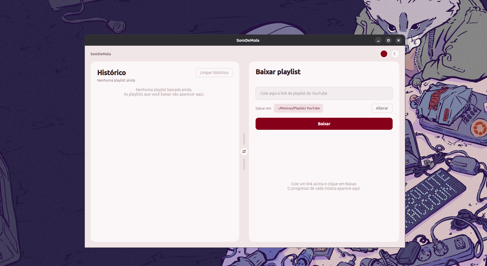

# 🎶 SomDeMala

Aplicativo de desktop para baixar playlists do YouTube em **MP3**. Cole o link da playlist e o SomDeMala baixa todas as músicas, já com título e capa, e organiza tudo numa pasta com o nome da playlist.

Funciona no **Windows** e no **Linux**, sem precisar instalar nada na versão empacotada.





## Funcionalidades

- **Download de playlists inteiras em MP3** (192 kbps), com título, artista e capa embutidos em cada arquivo.
- **Progresso em tempo real**, mostrando qual música está sendo baixada, o andamento da faixa atual e o total da playlist.
- **Histórico** de todas as playlists baixadas, com data, quantidade de músicas e um atalho para abrir a pasta.
- **Downloads inteligentes**: se você baixar a mesma playlist de novo, só as músicas novas são baixadas.
- **Layout ajustável**: troque os painéis de lado com o botão ⇄ e arraste a divisória para redimensionar. Clique duas vezes na divisória para voltar a 50/50.
- **Personalização**: escolha a cor principal num círculo de cores e alterne entre modo claro e escuro.
- Todas as preferências (cor, tema, posição dos painéis e pasta de destino) ficam salvas entre uma sessão e outra.

## Como usar

### Windows

1. Baixe o `SomDeMala-windows.zip` na aba **Releases** deste repositório.
2. Clique com o botão direito no arquivo e escolha **Extrair tudo**.
3. Abra a pasta extraída e dê dois cliques em **SomDeMala.exe**.

Na primeira vez, o Windows pode mostrar o aviso *"O Windows protegeu seu computador"*. Isso acontece porque o app não tem assinatura digital. Clique em **Mais informações → Executar assim mesmo**.

Mantenha o `.exe` dentro da pasta extraída, porque ele depende dos arquivos que estão ao lado dele. Para criar um atalho, clique com o botão direito no `.exe` e escolha **Enviar para → Área de trabalho**.

### Linux

1. Baixe o `SomDeMala-linux.tar.gz` na aba **Releases**.
2. Extraia e rode:

```bash
tar -xzf SomDeMala-linux.tar.gz
./SomDeMala/SomDeMala
```

Se aparecer o erro *"Could not load the Qt platform plugin xcb"*, instale a dependência que falta:

```bash
sudo apt install libxcb-cursor0
```

### No app

1. Cole o link de uma playlist do YouTube no campo da direita.
2. Se quiser, clique em **Alterar** para escolher outra pasta de destino.
3. Clique em **Baixar** e acompanhe o progresso.

A playlist precisa estar como **Pública** ou **Não listada**. Playlists privadas não podem ser acessadas.

## Rodando a partir do código

Para quem quer rodar o script direto pelo Python (exemplo no Ubuntu):

```bash
sudo apt install ffmpeg libxcb-cursor0 python3-venv
python3 -m venv ~/yt-env
source ~/yt-env/bin/activate
pip install -U yt-dlp PySide6
python SomDeMala.py
```

No Windows, instale o [Python](https://www.python.org/downloads/) e o [FFmpeg](https://ffmpeg.org/download.html) e rode `pip install -U yt-dlp PySide6` antes de executar o script.

## Gerando os executáveis

O executável precisa ser gerado no mesmo sistema em que vai rodar. Há três formas de fazer isso:

| Forma | Como |
|---|---|
| **Linux** | `bash build_linux.sh` gera `dist/SomDeMala-linux.tar.gz` |
| **Windows** | `powershell -ExecutionPolicy Bypass -File build_windows.ps1` gera `dist\SomDeMala-windows.zip` |
| **GitHub Actions** | Aba **Actions → Gerar executáveis → Run workflow**. As versões de Linux e Windows ficam disponíveis em **Artifacts** ao final da execução. |

Os scripts criam um ambiente Python isolado, baixam um FFmpeg que não depende do sistema e empacotam tudo com o [PyInstaller](https://pyinstaller.org/).

## Onde ficam os dados

| | Músicas (padrão) | Histórico e preferências |
|---|---|---|
| **Windows** | `Músicas\Playlists YouTube` | `%APPDATA%\SomDeMala` |
| **Linux** | `~/Música/Playlists YouTube` | `~/.local/share/baixador-playlist` |

O botão **Limpar histórico** apaga apenas a lista exibida no app. As músicas continuam nas pastas.

## Problemas comuns

**Os downloads pararam de funcionar.** O YouTube muda com frequência, e o yt-dlp é atualizado para acompanhar essas mudanças. Se você roda pelo código, use `pip install -U yt-dlp`. Se usa o executável, gere uma versão nova pelos scripts ou pelo GitHub Actions.

**"Nenhuma música encontrada".** Confira se a playlist está como Pública ou Não listada.

**Uma música aparece como "falhou".** O vídeo pode ter sido removido, estar bloqueado na sua região ou ter restrição de idade. As outras músicas da playlist continuam sendo baixadas normalmente.

## Aviso

Os Termos de Serviço do YouTube não permitem baixar conteúdo fora dos recursos oficiais da plataforma, e músicas protegidas por direitos autorais podem ter restrições legais. Use o SomDeMala com conteúdo próprio, liberado pelo autor ou sob licenças como Creative Commons. A responsabilidade pelo uso é de quem usa.

## Créditos

- [yt-dlp](https://github.com/yt-dlp/yt-dlp), que faz os downloads
- [FFmpeg](https://ffmpeg.org/), que converte o áudio para MP3 (build de [yt-dlp/FFmpeg-Builds](https://github.com/yt-dlp/FFmpeg-Builds), sob licença GPL)
- [PySide6 / Qt](https://doc.qt.io/qtforpython-6/), a interface gráfica
- [PyInstaller](https://pyinstaller.org/), o empacotamento

## Licença

<!-- Escolha uma licença e coloque aqui, por exemplo: Distribuído sob a licença MIT. Veja o arquivo LICENSE. -->
